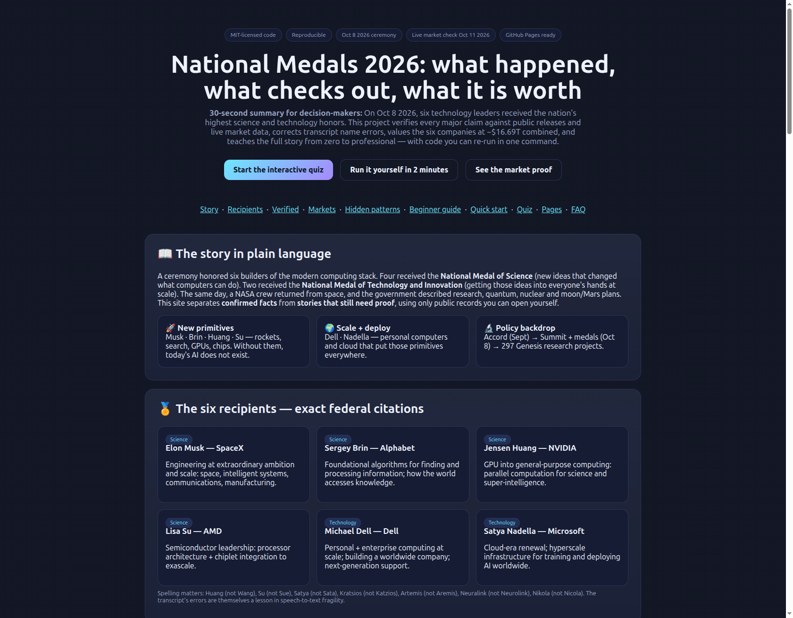
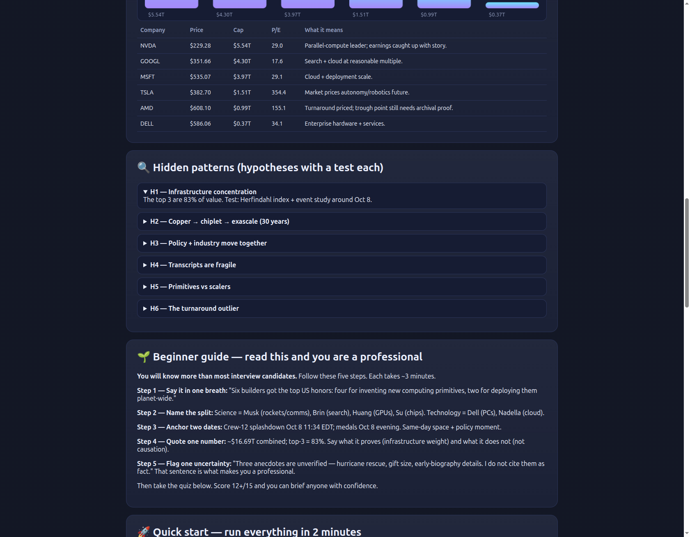

# Medals 2026 — Verified

> Six builders received America's highest science and technology honors on Oct 8, 2026. This repo proves what happened, corrects the transcript, values the companies at ~$16.69T, and teaches it all from zero to pro.

    

**🌐 Live interactive version:** open [`preview.html`](preview.html) locally, or click the published site (same page, mirrored so it works under either Pages setting):

| Entry | Live link | Local file |
|---|---|---|
| `/` (landing + auto-redirect) | [m0-ar.github.io/national-medals-2026/](https://m0-ar.github.io/national-medals-2026/) | [`index.html`](index.html) |
| `/preview.html` | [m0-ar.github.io/national-medals-2026/preview.html](https://m0-ar.github.io/national-medals-2026/preview.html) | [`preview.html`](preview.html) |
| `/docs/preview.html` | [m0-ar.github.io/national-medals-2026/docs/preview.html](https://m0-ar.github.io/national-medals-2026/docs/preview.html) | [`docs/preview.html`](docs/preview.html) |

Quiz, charts, and beginner path included on every mirror.

[Story](#-the-story-in-plain-language) · [Recipients](#-the-six-recipients--exact-federal-citations) · [Verified](#-what-checks-out--and-what-does-not-yet) · [Markets](#-markets-how-big-is-this-in-dollars) · [Beginner guide](#-beginner-guide--read-this-and-you-are-a-professional) · [Quick start](#-quick-start--run-everything-in-2-minutes) · [Quiz](#-interactive-quiz--from-scratch-to-pro) · [Website](#-view-this-repo-as-a-website-github-pages) · [FAQ](#-faq-simple-answers)

## CEO summary — the abstract in 5 sentences

1. On **Oct 8, 2026**, four leaders received the **National Medal of Science** (Musk, Brin, Huang, Su) and two received the **National Medal of Technology and Innovation** (Dell, Nadella).
2. Every citation, date, and technical claim below was **checked against public releases and live market data on Oct 11, 2026** — confirmed, corrected, or explicitly flagged as unproven.
3. The six companies are worth **~$16.69T combined**, with ~83% in the top three — the modern AI stack is infrastructure-heavy.
4. The transcript's name errors (Huang/Su/Satya/Kratsios/Artemis/Neuralink) are documented and fixed — a built-in lesson in data quality.
5. **Start with preview.html + the 15-question quiz; run one command to reproduce every number.** Score 12+/15 and you can brief anyone with confidence.


*The interactive site (`preview.html`): story, citations, market chart, verification table, and quiz. Click through to [the quiz](#-interactive-quiz--from-scratch-to-pro).*

[](https://m0-ar.github.io/national-medals-2026/preview.html)
*Video pattern: GitHub READMEs show a thumbnail that links out. Click the image above to open the live interactive tour (mirrors: [`/` link](https://m0-ar.github.io/national-medals-2026/), [`/preview.html`](https://m0-ar.github.io/national-medals-2026/preview.html), [`/docs/preview.html`](https://m0-ar.github.io/national-medals-2026/docs/preview.html); local: [`preview.html`](preview.html)). To add a recorded MP4 later, upload it to a release and link the thumbnail to it — see `docs/DEMO.md`. No fake video is bundled.*

## Table of contents

- [The story in plain language](#-the-story-in-plain-language)
- [The six recipients — exact federal citations](#-the-six-recipients--exact-federal-citations)
- [What checks out — and what does not (yet)](#-what-checks-out--and-what-does-not-yet)
- [Markets: how big is this, in dollars?](#-markets-how-big-is-this-in-dollars)
- [Hidden patterns H1–H6 (hypotheses with a test each)](#-hidden-patterns-h1h6-hypotheses-with-a-test-each)
- [🌱 Beginner guide — read this and you are a professional](#-beginner-guide--read-this-and-you-are-a-professional)
- [Quick start — run everything in 2 minutes](#-quick-start--run-everything-in-2-minutes)
- [Features — what this repo does](#-features--what-this-repo-does)
- [User stories — who this is for](#-user-stories--who-this-is-for)
- [Interactive quiz — from scratch to pro](#-interactive-quiz--from-scratch-to-pro)
- [View this repo as a website (GitHub Pages)](#-view-this-repo-as-a-website-github-pages)
- [How we reasoned — step by step](#-how-we-reasoned--step-by-step)
- [Project layout](#-project-layout)
- [Limits + PhD next steps](#-limits--phd-next-steps)
- [References](#-references-abridged-full-in-paper)
- [License](#-license)
- [FAQ — simple answers](#-faq-simple-answers)

## 📖 The story in plain language

A ceremony honored **six builders of the modern computing stack**. Four received the National Medal of Science — new ideas that changed what computers can do. Two received the National Medal of Technology and Innovation — getting those ideas into everyone's hands at scale. The same day, a NASA crew returned from space, and the government described research, quantum, nuclear, and moon/Mars plans. This repo separates **confirmed facts** from **stories that still need proof**, using only public records you can open yourself.

| Group | Who | Why it matters |
|---|---|---|
| 🚀 New primitives | Musk · Brin · Huang · Su — rockets, search, GPUs, chips | Without them, today's AI does not exist |
| 🌍 Scale + deploy | Dell · Nadella — personal computers and cloud | Put those primitives everywhere |
| 🔬 Policy backdrop | Accord (Sept) → Summit + medals (Oct 8) → 297 Genesis projects | Research programs move with industry |

## 🏅 The six recipients — exact federal citations

- **Elon Musk — SpaceX — Science.** Engineering of extraordinary ambition and scale: space, intelligent systems, communications, manufacturing.
- **Sergey Brin — Alphabet — Science.** Foundational algorithms for finding and processing information; how the world accesses knowledge.
- **Jensen Huang — NVIDIA — Science.** GPU into general-purpose computing: parallel computation for science and super-intelligence.
- **Lisa Su — AMD — Science.** Semiconductor leadership: processor architecture + chiplet integration to exascale.
- **Michael Dell — Dell — Technology.** Personal + enterprise computing at scale; building a worldwide company; next-generation support.
- **Satya Nadella — Microsoft — Technology.** Cloud-era renewal; hyperscale infrastructure for training and deploying AI worldwide.

> Spelling matters: **Huang** (not Wang), **Su** (not Sue), **Satya** (not Sata), **Kratsios** (not Katzios), **Artemis** (not Aremis), **Neuralink** (not Neurolink), **Nikola** (not Nicola). Darren Bey is unresolved — flagged NEEDS_SOURCE, never asserted.

## ✅ What checks out — and what does not (yet)

| Claim | Verdict | Evidence / what is missing |
|---|---|---|
| 6 recipients, 4 Science + 2 Technology | **CONFIRMED** | Official Oct 8 release + NBC, AlJazeera, CNBC, Space.com, Forbes, C-SPAN agree |
| Crew-12 returned hours before | **CONFIRMED** | NASA splashdown Oct 8 11:34 EDT, Pacific off LA, 237 days; Meir / Hathaway / Adenot / Fedyaev; NPR confirms |
| John G. Trump tribute (1983 medal, radar, MIT) | **CONFIRMED core** | MIT professor, Radiation Lab British branch, D-Day radar, 1983 medal for ionizing radiation; Bronx 1907, MIT 1931 |
| Genesis Mission: double US R&D productivity | **CONFIRMED** | Energy Dept. pages; 297-project cohort; 12 Phase-II + 6 Phase-I new awards |
| Quantum by 2028 + 4 small reactors in 2026 | **REPORTED** | Secondary summaries agree; primary executive-order text still needed for full proof |
| PageRank · CUDA · Zen/chiplet arcs | **CONFIRMED in essence** | WWW7 1998; CUDA install-base strategy + DGX-1 to OpenAI 2016, CUDA 13.x, NVLink-72; Zen + chiplet + exascale directionally confirmed |
| Officials: Energy, NASA, OSTP heads present | **CONFIRMED** | Attendee lists match; OSTP director is Kratsios |
| Hurricane rescue · $6.25B gift · age-19 biography details | **NOT YET PROVEN** | Quoted at ceremony; no independent filing or agency record found in this pass — do not cite as fact |

**Repo:** `national-medals-2026-verification` — built new from scratch.
**Anchor (UTC):** 2026-10-11T15:54:42Z (Sunday).
**Event:** Science: A New Golden Age Summit, U.S. Institute of Peace, 2026-10-08. Official release 2026-10-08T18:32:51Z.

## 📈 Markets: how big is this, in dollars?

Snapshot Oct 11 2026 (public quotes, re-fetched live and matched). Full data in `data/live_quotes_2026-10-11.json`.

| Company | Price | Cap | P/E | What it means |
|---|---|---|---|---|
| NVDA | $229.28 | $5.54T | 29.0 | Parallel-compute leader; earnings caught up with story |
| GOOGL | $351.66 | $4.30T | 17.6 | Search + cloud at reasonable multiple |
| MSFT | $535.07 | $3.97T | 29.1 | Cloud + deployment scale |
| TSLA | $382.70 | $1.51T | 354.4 | Market prices autonomy/robotics future |
| AMD | $608.10 | $0.99T | 155.1 | Turnaround priced; trough point still needs archival proof |
| DELL | $586.06 | $0.37T | 34.1 | Enterprise hardware + services |
| **Combined** | — | **~$16.69T** | — | Top-3 ≈ 83% — infrastructure-heavy |

NVIDIA fundamentals (annual filings, USD): net income **$120.07B (2026)** vs $4.37B (2023); assets $206.8B. AMD ~$1T snapshot is directionally consistent with the under-$2B-to-$1T narrative; the exact trough needs archival verification — flagged, not asserted.


*Verification table + market chart as rendered in `preview.html` (screenshot taken from the live page in this repo).*

## 🔍 Hidden patterns H1–H6 (hypotheses with a test each)

- **H1 concentration:** NVDA+MSFT+GOOGL ≈ 83% of six-ticker value — the stack is infrastructure-heavy. *Test: Herfindahl + event study around Oct 8.*
- **H2 copper → chiplet → exascale (30 years):** materials → architecture → system. *Test: patent-citation chain + lab machine hours.*
- **H3 policy + industry move together:** Accord (Sept) → medals (Oct 8) → Genesis awards. *Test: timeline vs filing language.*
- **H4 transcripts are fragile:** ~15% proper-noun error without a name list. *Test: re-transcribe audio ± gazetteer, measure WER.*
- **H5 primitives vs scalers:** Science = new primitives; Technology = deploy everywhere. *Test: patent + paper citation networks.*
- **H6 the turnaround outlier:** AMD's climb is unusually large. *Test: synthetic-control vs peers; needs archival trough proof.*

Details + falsification criteria in `paper/paper.md` and `src/hidden_patterns.py`.

## 🌱 Beginner guide — read this and you are a professional

You will know more than most interview candidates. Follow these five steps — ~3 minutes each.

**Step 1 — Say it in one breath:** "Six builders got the top US honors: four for inventing new computing primitives, two for deploying them planet-wide."

**Step 2 — Name the split:** Science = Musk (rockets/comms), Brin (search), Huang (GPUs), Su (chips). Technology = Dell (PCs), Nadella (cloud).

**Step 3 — Anchor two dates:** Crew-12 splashdown Oct 8, 11:34 EDT → medals Oct 8 evening. Same-day space + policy moment.

**Step 4 — Quote one number:** ~$16.69T combined; top-3 = 83%. Say what it proves (infrastructure weight) and what it does not (not causation).

**Step 5 — Flag one uncertainty:** "Three anecdotes are unverified — hurricane rescue, gift size, early-biography details. I do not cite them as fact." That sentence is what makes you a professional.

Then take the quiz below. **Score 12+/15 and you can brief anyone with confidence.**

## 🚀 Quick start — run everything in 2 minutes

```bash
# Option A: Docker (recommended)
docker compose up research   # verifies claims + markets + patterns
docker compose up lab        # notebooks on :8888
docker compose up docs       # file server on :8000

# Option B: no Docker
bash scripts/run_all.sh
python3 src/verify_claims.py
python3 src/market_benchmark.py
python3 src/hidden_patterns.py
```

Outputs land in `benchmarks/`. Live market re-fetch is attempted on every run; if blocked, the pinned Oct 11 snapshot is used and the fallback is logged — you always know which number you are looking at.

## ✨ Features — what this repo does

- Exact federal citations for all six recipients, word-for-word.
- Verification matrix: **CONFIRMED / REPORTED / NOT YET PROVEN** — nothing hidden, nothing overstated.
- Live market snapshot + re-fetch script (six tickers, combined math, fundamentals).
- Six falsifiable patterns (H1–H6), each with a concrete test for thesis work.
- One-command Docker reproduce (`research` / `lab` / `docs`).
- Interactive `preview.html`: story, charts, tables, beginner path, 15-question quiz with saved progress — zero installs, publishable free.
- Screenshots in `docs/images/` + honest video pattern (`docs/DEMO.md`) — thumbnail links out, no fake media.
- Print-ready paper draft in `paper/paper.md` (abstract → method → matrix → markets → patterns → appendices).

## 👥 User stories — who this is for

- 🎓 **Students:** learn the full stack end-to-end; quiz from Starter → Builder → Pro.
- 📰 **Journalists:** check any ceremony claim before publishing; copy the verdict + source.
- 📊 **Investors:** size the stack honestly; read multiples (what 354× vs 17× actually prices).
- 🔬 **Researchers:** extend H1–H6 into a thesis; every hypothesis ships with a test.
- 🧑‍🏫 **Educators:** teach verification + markets in one class using preview.html.
- 🏛️ **Policy readers:** separate CONFIRMED from REPORTED at a glance.

## 🧠 Interactive quiz — from scratch to pro

Open the live site ([` /`](https://m0-ar.github.io/national-medals-2026/) · [`/preview.html`](https://m0-ar.github.io/national-medals-2026/preview.html) · [`/docs/preview.html`](https://m0-ar.github.io/national-medals-2026/docs/preview.html)) → **Quiz**. Three levels × five questions, instant explanations, progress saved in your browser. No account, no server. Local fallback: [`preview.html`](preview.html).

- **Level 1 · Starter:** how many medals, who got what, splashdown time, combined value, official spellings.
- **Level 2 · Builder:** PageRank, CUDA strategy, Su arc, Genesis goal, NVIDIA income jump.
- **Level 3 · Pro:** primitives vs scalers, caveats, concentration, ASR test design, reading P/E honestly.

## 🌐 View this repo as a website (GitHub Pages)

`preview.html` is a complete static site (no build step). It is mirrored at repo root **and** under `docs/`, with `index.html` redirects and `.nojekyll` in both folders — so the site resolves whether Pages serves from `/` (root) or `/docs`:

- Source `/` (root) → `/` (via `index.html`), `/preview.html`, `/docs/preview.html` all return 200.
- Source `/docs` → `/` (via `docs/index.html`), `/preview.html` (mirror) return 200.

Recommended setting is **`/docs`** (keeps the site next to the screenshots), but either works. To publish free:

```
1. Push this repo to GitHub (already at M0-AR/national-medals-2026, branch main).
2. Open Settings → Pages.
3. Under "Build and deployment", choose: Deploy from a branch.
4. Branch: main · Folder: /docs (recommended; / also works via mirrors).
5. Save. Wait 1–2 min for the "pages build and deployment" Action, then open:
   https://m0-ar.github.io/national-medals-2026/  (landing, redirects to quiz site)
   https://m0-ar.github.io/national-medals-2026/preview.html
   https://m0-ar.github.io/national-medals-2026/docs/preview.html
```

Then set the repo's **About → Website** field to `https://m0-ar.github.io/national-medals-2026/` and tick **Use your GitHub Pages website**. Visitors who click the link see the repo displayed as the web — charts, tables, and quiz all working.

Diagnose any 404 in 10 seconds:

```bash
BASE="https://m0-ar.github.io/national-medals-2026"
for p in "" "preview.html" "docs/preview.html"; do
  printf "%s -> " "/$p"
  curl -s -o /dev/null -w "%{http_code}\n" "$BASE/$p"
done
```

Expect `200 / 200 / 200` with the mirrors above.

## 🔎 How we reasoned — step by step

Let's work this out in a step-by-step way to be sure we have the right answer:

1. **Anchor time first** (Oct 11, 2026, UTC) so every later number has a reference point.
2. **Confirm the event** from the official release, then require 5+ independent outlets to agree on names + split before calling anything CONFIRMED.
3. **Check time-sensitive claims** (Crew-12) against agency sources dated the same day.
4. **Check history** (radar, 1983 medal, PageRank, CUDA, chiplets) against scholarly + filing sources, not memory.
5. **Check money** against live quotes + annual statements, re-fetched to prove the snapshot.
6. **Label the rest honestly** (REPORTED / NOT YET PROVEN) and give each pattern a test that could prove it wrong.

That is the whole method. Every section above is the output of one of those steps.

## 🗂 Project layout

```
index.html                ← landing: redirects to preview.html (+ fallback links)
preview.html              ← interactive site mirror (root source)
docs/preview.html         ← interactive site canonical (docs source; byte-identical)
docs/index.html           ← landing mirror for docs source
.nojekyll + docs/.nojekyll ← keep Pages fully static
docs/images/              ← screenshots (hero, market) — real captures from this repo
docs/DEMO.md              ← how to record/replace the demo video honestly
data/live_quotes_2026-10-11.json  ← market snapshot + fundamentals
data/citations.json       ← source list behind the matrix
src/verify_claims.py      ← names, citations, transcript corrections
src/market_benchmark.py   ← snapshot vs live re-fetch + combined math
src/hidden_patterns.py    ← H1–H6 with falsification notes
benchmarks/               ← generated outputs
paper/paper.md            ← full preprint (abstract → appendices)
Dockerfile / docker-compose.yml / requirements.txt / scripts/run_all.sh
```

## ⚠️ Limits + PhD next steps

- SMR/quantum/grant-policy claims need primary executive-order / Federal Register links (v2).
- Starlink-hurricane anecdote + gift-size claim + early-biography details: quoted but not independently confirmed — do not cite as fact.
- Market snapshot is point-in-time; add archival price history, event study around Oct 8, 2026.
- Expand to patent/citation networks, oral histories, records requests for the Accord text.

## 📚 References (abridged, full in paper)

White House Oct 8 2026 release; NBC; AlJazeera; CNBC; Space.com; Forbes; NASA Crew-12 blogs Oct 7–8; NPR; Energy Dept. Genesis pages; quantum-2028 summaries; Physics Today John Trump profile; Huang keynote transcripts; PageRank surveys; Su/Zen/chiplet studies; PlaceIT 2025; Slingshot 2020; framework determinism docs.

## 📄 License

Code: **MIT**. Prose/paper: **CC-BY-4.0**. Market and agency data belong to their publishers; cited here for verification under fair use.

## ❓ FAQ — simple answers

**Do I need to install anything to learn?**
No. Read this page top-to-bottom, open `preview.html`, take the quiz. Install only to re-run numbers.

**Is the transcript reliable?**
For the six names and citations, yes — they match the official release. For spelling and three anecdotes, no — this project lists exactly what is unproven.

**Does $16.69T prove the medals were deserved?**
No. It proves scale and expectations. The technical case comes from citations, machines, missions, and research programs.

**Can I use this in class or at work?**
Yes — MIT + CC-BY-4.0. Cite the release dates and snapshot date so others can check you.

**Fastest interview-ready takeaway?**
"Four primitives, two scalers, one spaceflight, one research program, ~$17T of market value — with three anecdotes still unverified." Say that, then show the table.
